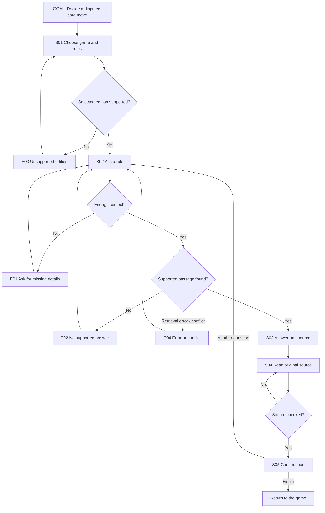

# Week 06 — User flow and critical states

The flow **starts with the user's goal** and only then enters the first screen. Each decision has a recovery route. IDs match the editable Figma frames and the Week 5 screen labels.

## Main path

**Goal → S01 → S02 → S03 → S04 → S05 → return to game.** The primary action of S03 is `Read source passage`. The only route to S05 is after the player acknowledges having checked the source. Users are not forced to claim that the entire group agreed.

## Exceptional branches

**E01 — Missing details:** The question omitted a relevant card or phase. Ask one specific follow-up; preserve the question and resume. This protects against guessing.

**E02 — No supported answer / empty evidence:** The selected rulebook has no sufficient passage. Present a plain-language empty state with Edit question and Change edition. Never invent a passage to make a success state.

**E03 — Unsupported edition:** Clearly identify the unsupported ruleset and return to selection. Do not silently use the edition from another game or deck.

**E04 — Retrieval error or conflicting evidence:** Explain that verification failed, keep the player's question, offer Retry/Edit. No definitive answer is shown while source evidence conflicts.

## Explicit design assumptions

- Edition selection and the citation's placement are **proposed safeguards**, not demonstrated user preferences.
- The example UNO ruling is placeholder copy. The implementation must use an appropriate, permitted source with a precise location before declaring support.
- Wireframes depict intended states. They are not live navigation or an implemented AI assistant.

## Direct links

[Main decision screen](https://www.figma.com/design/TsqmdorEJi0IQe42RTquvr?node-id=1-47) · [Empty evidence state](https://www.figma.com/design/TsqmdorEJi0IQe42RTquvr?node-id=1-111) · [Error state](https://www.figma.com/design/TsqmdorEJi0IQe42RTquvr?node-id=1-139) · [Confirmation](https://www.figma.com/design/TsqmdorEJi0IQe42RTquvr?node-id=1-79) · [Desktop main decision](https://www.figma.com/design/TsqmdorEJi0IQe42RTquvr?node-id=6-2)
