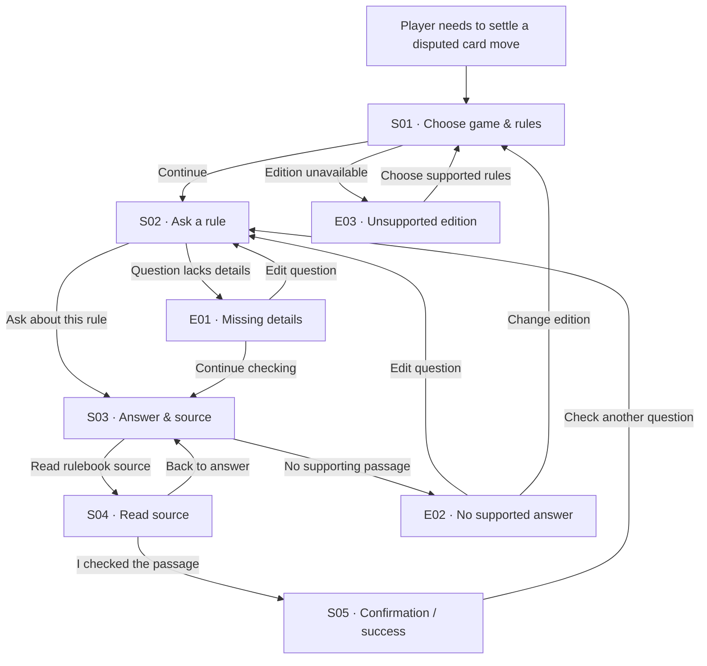

# Prototype specification, map, and limitations

**Figma:** https://www.figma.com/design/XaM92SjirDruf467HMzwZD

**Click-through:** https://www.figma.com/proto/XaM92SjirDruf467HMzwZD?node-id=1-4&starting-point-node-id=1%3A4

## Task-centered flow

## Screen inventory and why each exists

| Figma frame | Purpose | Main action / destination |
| --- | --- | --- |
| S01 · Choose game & rules | Scope game, edition, expansions | Continue → S02 |
| S02 · Ask a rule | State concrete disputed move | Ask → S03 |
| S03 · Answer & source | Make the proposed ruling and source discoverable | Read source → S04 |
| S04 · Read source | Let user inspect the cited rulebook passage | I checked passage → S05 |
| S05 · Confirmation | Confirm source review, not game enforcement | Check another question → S02 |
| E01 · Missing details | Explain missing context, avoid unsupported guess | Continue → S03; edit → S02 |
| E02 · No supported answer | State uncertainty when evidence is missing | Edit → S02; change rules → S01 |
| E03 · Unsupported edition | Prevent silent use of a different ruleset | Change rules → S01 |

## Known limitations (visible in the file and reported to testers)

1. **Scripted example.** One game, edition and question are preset; fields look editable but typed input is not supported.
2. **Static answer and source placeholders.** No retrieval, RAG model or real PDF viewer is connected. Source page number is intentionally not asserted.
3. **No validation of rule correctness.** The suggested answer is illustration only and requires checking a permitted source in the actual product.
4. **Simulated exceptional branches.** The tester chooses the relevant explicit branch button; backend errors are not detected automatically.
5. **No persistence or timing.** Choices and confirmation do not update a database; the prototype does not measure duration automatically.
6. **Partial interactivity.** Only controls needed for the selected task and its recovery paths are clickable. Decorative header and explanatory text are not interactive.
7. **No usability outcomes yet.** The informal peer trial has not been performed and there are no participant observations.

## Auto Layout and hierarchy

Each screen is an individually named 390px-wide mobile Auto Layout frame. Inner cards, fields, and buttons are stacked Auto Layout children. The main decision screen prioritizes the question, ruling, evidence and **Read the rulebook source**; secondary recovery stays below. S05 is clearly a success state. This prototype is a direct progression from Week 6 wireframes, not a redesign of the entire imagined product.

## Practical click test

From S01: Continue → Ask about this rule → Read the rulebook source → I checked the passage. The result should be S05. Also try S02 → Try a question without details → E01 → Edit my question, and S03 → What if no source is found? → E02. All listed transitions were created and programmatically checked as native Figma `ON_CLICK` / `NAVIGATE` reactions.
