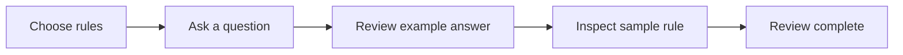
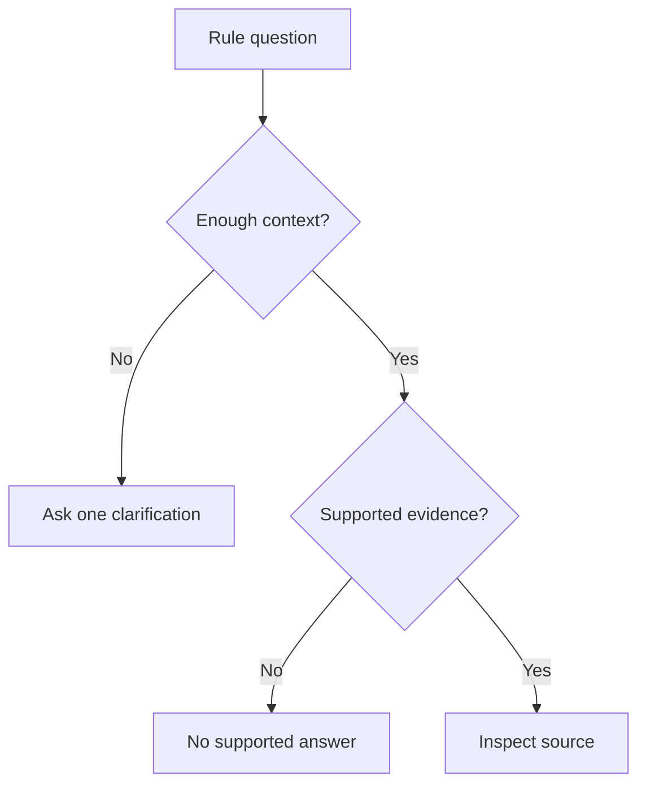

<!--@slide Welcome-->
# Week 08 — Usability testing and mini UI guideline

**Rulebook** · Board-game rules companion with source references

Nevzat Kayıkçı · JWM27Z · UX/UI Design · University of Pécs

---

<!--@slide Core task-->
# A disputed card move needs a traceable ruling

In the first research account, an UNO group checked whether +4 could follow +2, searched online and read rules. The design keeps the task narrow: examine one move and its evidence.

This **earlier account** is not a Week 08 usability-test result.

---

<!--@slide Prototype-->
# One question, five steps

[**Open the refined Figma prototype**](https://www.figma.com/proto/lDLN7kR1Y8MTZruP0Ku3JR?node-id=2-4&starting-point-node-id=2%3A4)

---

<!--@slide Test goals-->
# Two questions guide the test

**Goal 1:** Can a player navigate to evidence without moderator hints?

**Goal 2:** Can they recognize when evidence is not verified or available?

The prototype uses a preset UNO question; genuine free-text input cannot yet be tested.

---

<!--@slide Method-->
# Three independent, short student sessions are planned

**Participants:** U01–U03, students familiar with card or board games.

**Measures:** completion, time, backtracks, hesitations, source interpretation, error recovery and spontaneous words.

**Status:** 0/3 actual sessions recorded. No invented observations.

---

<!--@slide Task-->
# The task must not reveal the interface solution

**Scenario:** “You are playing cards with friends. Someone questions whether a proposed move is allowed. The group wants to check before continuing.”

**Task:** “Use this prototype to investigate the disputed move and decide what you would tell your friends.”

Observe silently.

---

<!--@slide Consent-->
# The participant chooses whether to take part

“I am testing the interface, not you. May I write anonymous notes about what you do and say? There is no recording, and you may stop at any time.”

Consent responses and actual test results are **not collected**.

---

<!--@slide Pre-test issues-->
# Design inspection found four risks — not user-test findings

| Severity | Design-review risk |
| --- | --- |
| HIGH | Placeholder citation appears authoritative |
| HIGH | Prefilled question cannot test question entry |
| MEDIUM | Confirmation suggests an authoritative ruling |
| MEDIUM | Unsupported states need more explicit labels |

Each needs validation in real sessions.

---

<!--@slide Fixes-->
# Make the evidence status visible

**Before:** plausible answer and source placeholder.

**After:** “EXAMPLE ANSWER · NOT VERIFIED”, “SAMPLE RULEBOOK TEXT”, and “Review complete” instead of claiming a proven ruling.

The primary action is **Inspect the rule passage**.

---

<!--@slide Exceptional states-->
# Recovery belongs in the main task

The prototype also has unsupported-edition and source-load error screens.

---

<!--@slide UI system-->
# Role-based colors support readable decisions

**11 semantic color roles** × Light/Dark modes; **five Inter text styles**; 4, 8, 12, 16, 24, 32px spacing.

Examples: text #111827 on white **17.74:1**; white CTA on blue #1D4ED8 **6.70:1**; interactive border #64748B on white **4.76:1**.

W3C AA thresholds: normal text 4.5:1, critical non-text UI 3:1.

---

<!--@slide Feedback and limits-->
# A redesign is not proof of improved usability

Actual feedback: **not collected**.

The prototype does not include editable input, live AI retrieval, verified document pages or measured performance.

Next: conduct three independent trials, capture observation/quote/interpretation separately, re-rank severity, then refine again.

---

<!--@slide Thank you-->
# Thank you for listening

**Rulebook — UX/UI Design**

[Research FigJam](https://www.figma.com/board/YWuvTvn8MmNc0KHxVGwvgB) · [Figma prototype + UI guideline](https://www.figma.com/design/lDLN7kR1Y8MTZruP0Ku3JR)

Nevzat Kayıkçı · JWM27Z
