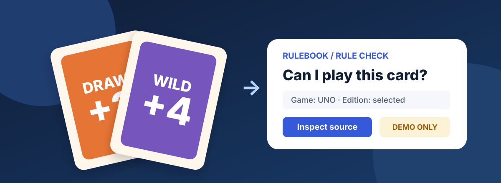
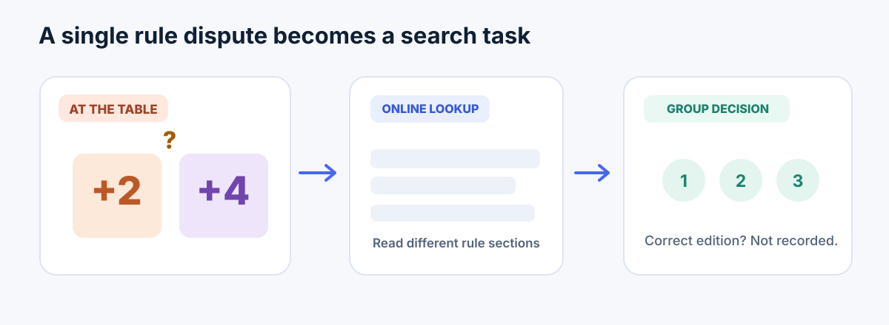
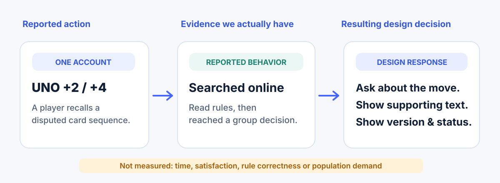
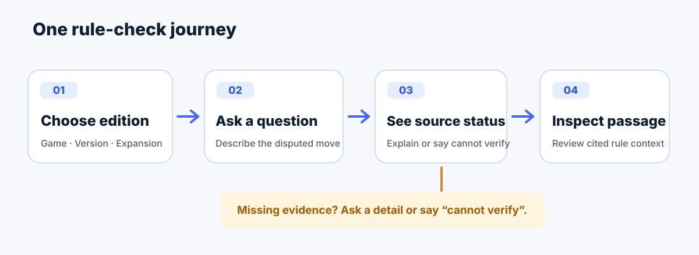
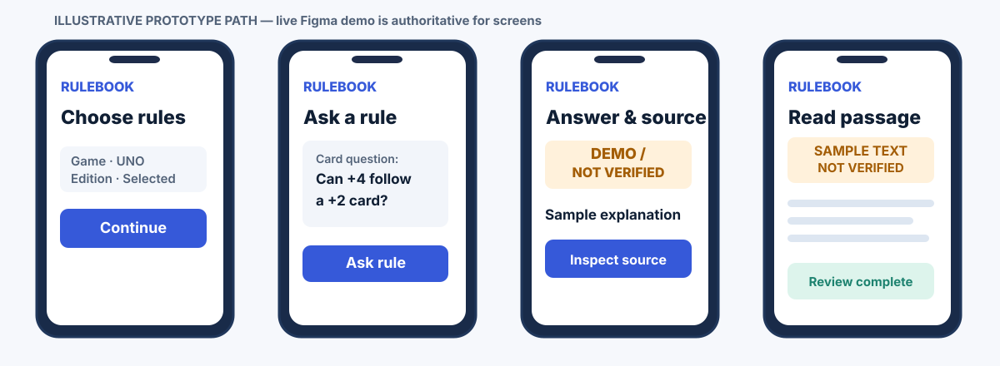
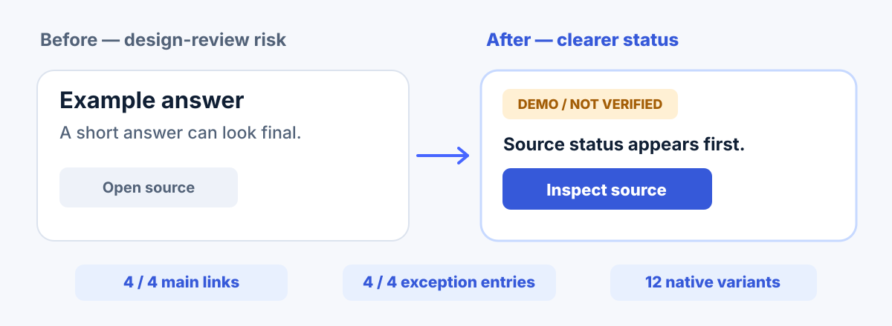
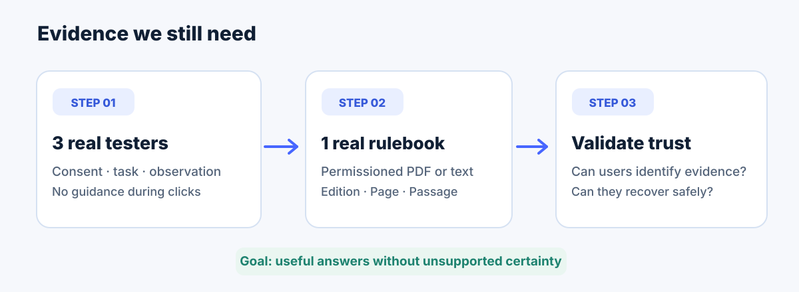

<!--@slide 01 — Opening-->
# One disputed card can stop the game

**RULEBOOK** — Board-game rules companion with source references

Nevzat Kayıkçı · **JWM27Z** · Computer Science Engineering · University of Pécs

---

<!--@slide 02 — The problem-->
# A single rule question can send the whole group searching

A real participant recalled an **UNO +2 / +4 dispute**. The group searched online, read rules and made a decision.

*The exact edition and original source were not recorded.*

---

<!--@slide 03 — Research insight-->
# One real incident suggested a source-first experience

**Observed through self-report:** a specific question → online search → reading the rules.

**Design implication:** ask about the move and **show the passage behind the answer**.

*One retrospective account; not three usability tests.*

---

<!--@slide 04 — Design decision-->
# Every answer must stay connected to the selected rules

**Choose edition → Ask → Check source status → Inspect passage**

If the question lacks detail, **ask a follow-up**. If evidence is missing, **say “cannot verify.”**

---

<!--@slide 05 — Prototype demo-->
# The clickable prototype connects the question to its source

**[OPEN LIVE FIGMA DEMO](https://www.figma.com/proto/shH7rwYFexBW16cpIfhWZy?node-id=2-4&starting-point-node-id=2%3A4)**

*Show only S01 → S02 → S03 → S04, then the review step. The passage is **DEMO / NOT VERIFIED**, not an official rule.*

---

<!--@slide 06 — Iteration and evidence-->
# We improved the evidence warning — but have not proven usability

**Designer-led changes:** clearer source status, one primary action, reusable component states.

**Technical checks:** 4/4 main links · 4/4 exception entries · 12 native variants.  
**Human test results:** not yet collected.

---

<!--@slide 07 — Next step and thanks-->
# Next, test whether people recognize trustworthy evidence

**Next:** three real, consented usability sessions + one permissioned rulebook with accurate citations.

**Thank you for listening. Questions?**

Nevzat Kayıkçı · JWM27Z
