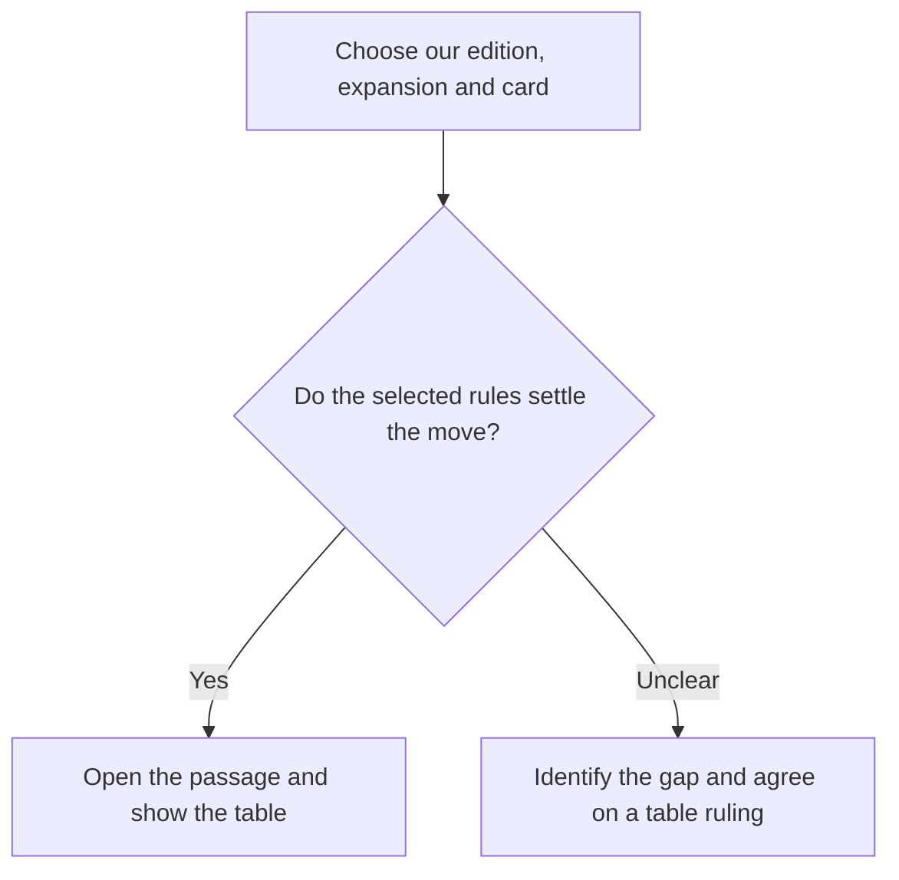

<!--@slide Opening-->
# Can I still take my normal move?

A player puts down a card. One friend opens the base rules. Another reaches for the expansion booklet. Nobody moves.

Nevzat Kayıkçı · UX/UI Design · Week 1

---

<!--@slide First pitch-->
# Show the table what settles the question

---

<!--@slide Takeaway-->
# Will players check while everyone waits?

Give five players four covered questions and one unresolved question each. Our targets are a correct move and passage within 90 seconds in 16 of 20 covered attempts, and recognition of the gap in 4 of 5 unresolved attempts.

[Explore the FigJam board](https://www.figma.com/board/8CpfdHJFAHqpO9RcMVzzMj)
