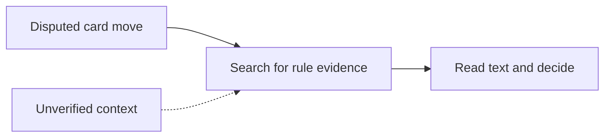

<!--@slide Welcome-->
# Week 02 — User research, persona and journey

**Rulebook: Board-game rules companion with source references**

Nevzat Kayıkçı · JWM27Z · University of Pécs

---

<!--@slide Research question-->
# What happens when a rule is disputed during play?

We wanted to understand how players identify an unclear rule, where they search and how they reach a decision.

**Method:** one short retrospective, text-based interview (participant P01). No live observation or timing was performed.

---

<!--@slide Scenario-->
# A real incident: UNO +2 and +4

P01 described a group asking whether a Wild Draw Four could follow a Draw Two card.

The participants searched online, read rules and decided not to play the +4 in that situation.

**Evidence:** reported sequence of actions. Exact rule edition and source were not recorded.

---

<!--@slide Evidence boundary-->
# Separate what was said from what we infer

| Evidence | Research interpretation |
| --- | --- |
| Players discussed a specific card combination | Questions can start from a concrete move |
| The group searched online and read rules | Supporting rule text matters to their decision process |
| The group arrived at a ruling | The interface should help inspect, not invent, evidence |

Unknown: search duration, feelings, official source, edition, device and number of players.

---

<!--@slide Affinity clusters-->
# Three clusters organize the incident

Our clusters are descriptive, not statistical patterns.

---

<!--@slide Proto-persona-->
# The player needs a ruling in the current game

**Proto-persona P01** — a participant in a group UNO game.

- Goal: establish whether the proposed move is legal.
- Reported behavior: search and read online rules.
- Risk to test: answers from a wrong edition may be misleading.

No age, occupation or emotions were invented.

---

<!--@slide Journey-->
# One journey: dispute → lookup → reading → decision

| Step | What the group did | Design opportunity |
| --- | --- | --- |
| Dispute | Questioned +2 → +4 | Enter the card situation |
| Search | Looked online | Scope search to chosen rules |
| Read | Consulted rule text | Show directly inspectable citations |
| Decide | Reached a group ruling | Keep source and context visible |

---

<!--@slide Next step-->
# Test citation visibility in a live task

Observe three to five future rule lookups and measure source-opening behavior, time and whether the selected edition matches the game.

**Research limit:** one retrospective incident does not establish population-wide needs. Consent to use direct original-language quotations must be confirmed before formal academic use.

[Week 2 FigJam](https://www.figma.com/board/8CpfdHJFAHqpO9RcMVzzMj)

---

<!--@slide Thank you-->
# Thank you for listening

Questions?

Nevzat Kayıkçı · JWM27Z
