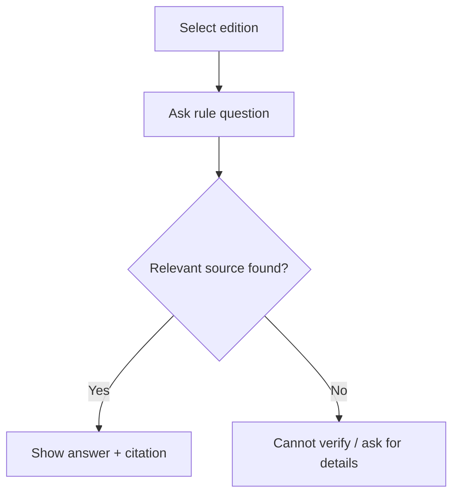

<!--@slide Welcome-->
# Week 03 — Usability and accessibility audit

**Rulebook UX/UI project**

Nevzat Kayıkçı · JWM27Z · University of Pécs

---

<!--@slide Audit scope-->
# One service, one concrete rule question

**Reference page:** UltraBoardGames — UNO Game Rules

**Task:** investigate whether a +4 card can be played after a +2 card.

**Method:** structured content and heuristic inspection of the available page representation; no live keyboard/screen-reader session.

---

<!--@slide Finding 1-->
# Game search is not a rule-level question tool

The page's general board-game search and long rule text do not directly answer the situation-specific card combination.

**Consequence:** the player needs to browse and interpret several passages.

**Proposal:** accept a short situational rule question, then point to relevant sections.

---

<!--@slide Finding 2-->
# A +2/+4 question spans several rule sections

The Draw Two and Wild Draw Four descriptions are not packaged as one question-and-answer entry.

Their context matters: receiving a draw penalty is not the same as taking a normal turn.

**Proposal:** distinguish these contexts and cite both needed passages.

---

<!--@slide Finding 3-->
# A correct passage from the wrong edition is unsafe

The inspected page does not clearly identify an applicable rulebook edition beside the specific ruling.

**Risk:** confusing different versions or variants.

**Proposal:** show game, edition, expansion and document identity beside every answer.

---

<!--@slide Accessibility risks-->
# Two structural issues deserve manual verification

1. An apparent heading jump from H2 to H4 under Special Cards may complicate heading navigation.
2. Card images are generic “Image” markers in the text-only representation; their actual alternatives need checking.

**Important:** these are unverified accessibility concerns, not certified WCAG failures.

---

<!--@slide Other interface observations-->
# Optional content can compete with the main decision

Related editions and shopping-style links appear after lengthy rule content.

**Consequence to investigate:** attention may shift away from the relevant ruling.

**Proposal:** put the short answer, evidence and the way back to the game first.

---

<!--@slide Design safeguards-->
# Our proposed interface should prevent unsupported certainty

These are design decisions derived from audit risks, not observed user preferences.

---

<!--@slide Next validation-->
# Do a real keyboard and screen-reader check

Inspect the DOM heading structure, image alternatives, focus visibility and link names in a browser; then try the proposed task with participants.

[Week 3 FigJam](https://www.figma.com/board/8CpfdHJFAHqpO9RcMVzzMj)

---

<!--@slide Thank you-->
# Thank you for listening

Questions?

Nevzat Kayıkçı · JWM27Z
