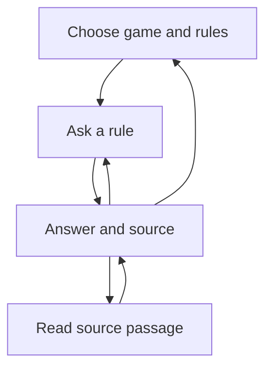

<!--@slide Welcome-->
# Week 05 — Information architecture and user flow

**Rulebook: one cited decision in a group game**

Nevzat Kayıkçı · JWM27Z · University of Pécs

---

<!--@slide Goal-->
# Start with the player's goal, not a dashboard

“Our group is playing UNO. Can I put a +4 card after a +2?”

The interface should support choosing the right ruleset, asking about the move and opening source evidence.

---

<!--@slide Content hierarchy-->
# Essential information comes before optional features

**P0:** game, edition, expansions, question, ruling/unknown state, document identity, supporting excerpt, clarification.

**P1:** loading/retry feedback and keyboard-accessible source link.

**Excluded:** social feed, profiles, full game board, camera, voice and scoring.

---

<!--@slide Sitemap-->
# Four core task screens

The Week 6 extension adds a visible confirmation screen after source review.

---

<!--@slide What happens on each screen-->
# Each screen has one leading job

| Screen | Main action |
| --- | --- |
| Choose game & rules | Pick the correct edition |
| Ask a rule | Describe a card combination |
| Answer & source | Review ruling or uncertainty; open evidence |
| Read source | Inspect the rulebook context |

---

<!--@slide Decision branches-->
# Errors must have understandable exits

- Unsupported edition → choose an available ruleset.
- Missing context → ask one specific follow-up.
- No evidence → “Cannot verify” with no invented citation.
- Conflicting passages → show uncertainty, not a forced yes/no.
- Network failure → retry while preserving question and version.

---

<!--@slide Label vocabulary-->
# Proposed labels are not validated labels

“Choose game” · “Edition & expansions” · “Ask a rule” · “Answer & source” · “Read source” · “Cannot verify”

**Pending:** label-comprehension trials with three real participants. The materials contain the protocol, not fabricated participant responses.

---

<!--@slide Handoff-->
# The sitemap becomes low-fidelity wireframes

Prioritize answer and source together, then create mobile and desktop views and reachable exceptional states.

**Success to test:** can a player locate an inspectable supporting passage and understand when the available source does not justify a decision?

[Week 5 FigJam](https://www.figma.com/board/qM115e40DgRrVNNfGI1Eu8)

---

<!--@slide Thank you-->
# Thank you for listening

Questions?

Nevzat Kayıkçı · JWM27Z
