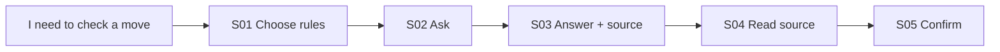

<!--@slide Welcome-->
# Welcome to my Week 6 wireframe presentation

**Rulebook — Board-game rules companion**

Nevzat Kayıkçı · JWM27Z  
Computer Science Engineering · University of Pécs

---

<!--@slide Design goal-->
# One task: check a disputed move and its source

A group is playing UNO and wants to know whether a +4 card can follow a +2 card.

**User goal:** Find a supported answer, inspect the rulebook passage, and return to the game.

**Design choice:** Keep this flow focused; no account, shop or game simulator.

---

<!--@slide Main flow-->
# The flow begins with the player's goal

Five connected mobile screens form one task with a clear finish.

[Figma: complete Week 6 wireframes](https://www.figma.com/design/TsqmdorEJi0IQe42RTquvr)

---

<!--@slide Ruleset-->
# S01 — Choose the correct rules first

The player selects the **game**, **edition** and any **expansions**.

This helps prevent a ruling from the wrong version.

**Primary action:** Continue → Ask a rule.

[Figma: S01 mobile](https://www.figma.com/design/TsqmdorEJi0IQe42RTquvr?node-id=1-4)

---

<!--@slide Ask-->
# S02 — Ask about the current move

A focused question field shows the selected ruleset.

> Can I play +4 on +2?

**Primary action:** Ask about this rule.

If context is missing, the design asks a follow-up rather than guessing.

[Figma: S02 mobile](https://www.figma.com/design/TsqmdorEJi0IQe42RTquvr?node-id=1-29)

---

<!--@slide Main decision-->
# S03 — The answer and source belong together

The **main decision screen** presents:

- A concise ruling or explicit uncertainty
- A preview of the supporting passage
- One prominent action: **Read source passage**

No definite answer should appear without sufficient evidence.

[Figma: S03 mobile](https://www.figma.com/design/TsqmdorEJi0IQe42RTquvr?node-id=1-47)

---

<!--@slide Source and confirmation-->
# S04 → S05 — The player verifies and confirms

**S04 — Read source:** Show the original passage, rulebook version and section context.

**S05 — Confirmation:** The player selects **I checked this source** and can return to the game.

Confirmation means the evidence was reviewed — **not** that the app enforces a move or proves group agreement.

[Figma: Read source](https://www.figma.com/design/TsqmdorEJi0IQe42RTquvr?node-id=1-64) · [Confirmation](https://www.figma.com/design/TsqmdorEJi0IQe42RTquvr?node-id=1-79)

---

<!--@slide Critical states-->
# Critical states prevent misleading certainty

| State | User sees | Recovery |
| --- | --- | --- |
| **E01 Missing detail** | More context needed | Add the card / phase |
| **E02 No evidence** | No supported ruling | Edit question / edition |
| **E03 Unsupported edition** | Wrong ruleset available | Choose another edition |
| **E04 Error / conflict** | Verification failed | Retry / edit |

These are branches of the same task, not unrelated screens.

---

<!--@slide Responsive design-->
# The main decision works on mobile and desktop

**Mobile — 384px:** A vertical Auto Layout stack leads from answer to source and the main action.

**Desktop — 1040px:** A horizontal Auto Layout places the **ruling on the left** and the **source on the right**.

The content and next action remain the same.

[Figma: mobile decision](https://www.figma.com/design/TsqmdorEJi0IQe42RTquvr?node-id=1-47) · [Figma: desktop decision](https://www.figma.com/design/TsqmdorEJi0IQe42RTquvr?node-id=6-2)

---

<!--@slide Layout and rationale-->
# Hierarchy matters more than visual styling

1. **Ruleset:** Which rulebook applies?
2. **Question:** What move is disputed?
3. **Decision:** What does the evidence support?
4. **Source:** Can the player inspect it?
5. **Confirmation:** Can the group continue?

The file uses named, editable frames, **Auto Layout**, black-and-white shapes and flow annotations — no decorative elements.

---

<!--@slide Limitations and next step-->
# What remains to validate?

This is a **low-fidelity design**, not a working AI service. The displayed ruling is illustrative, and exact citations need a permitted source document.

The Week 5 label test with three people has not yet been conducted. Next, test whether players understand the labels, notice uncertainty and can find the cited passage.

[View the Figma wireframes](https://www.figma.com/design/TsqmdorEJi0IQe42RTquvr)

---

<!--@slide Thank you-->
# Thank you for listening

Questions?

Nevzat Kayıkçı · JWM27Z · University of Pécs
