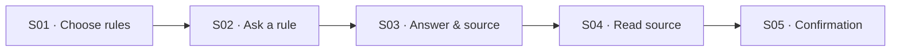
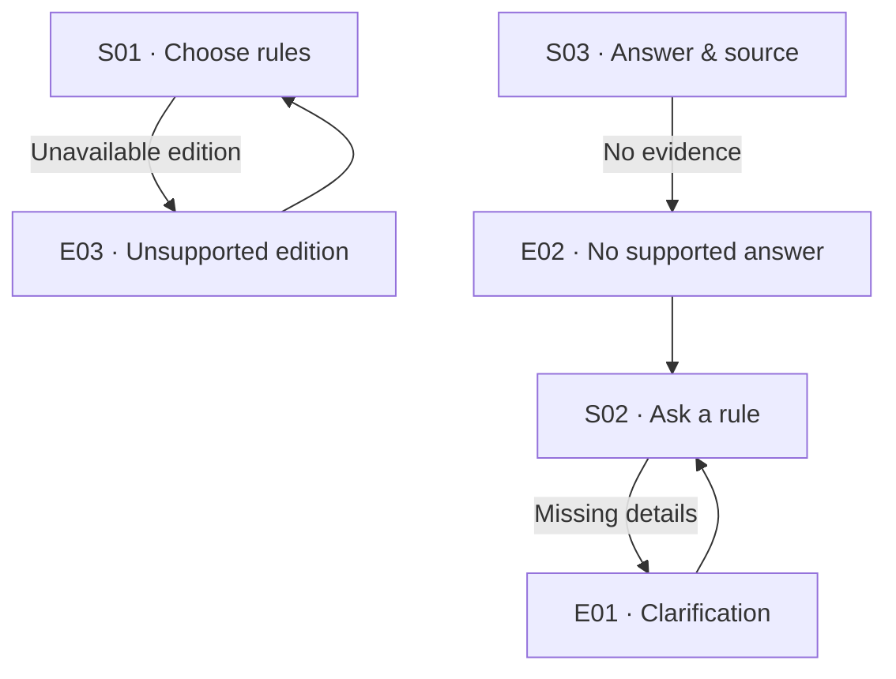

<!--@slide Welcome-->
# Week 07 — Clickable prototype & first feedback

**Rulebook** — a board-game rules companion with source references

Nevzat Kayıkçı · JWM27Z · Computer Science Engineering · University of Pécs

---

<!--@slide The user goal-->
# One rule dispute, one decision

During a game, players ask whether a +4 card may follow a +2 card in UNO.

The prototype focuses on **finding the rule, viewing its source, and confirming the check** — not running the game.

**Task:** Settle a disputed move using the rules selected at the table.

---

<!--@slide Prototype map-->
# The five-screen path supports the whole task

[Open the clickable Figma prototype](https://www.figma.com/proto/XaM92SjirDruf467HMzwZD?node-id=1-4&starting-point-node-id=1%3A4)

---

<!--@slide Main decision-->
# The answer is not complete without its source

The main decision screen presents the question, an **example ruling**, and a clear action to inspect the rulebook passage.

**Main action:** “Read the rulebook source”

**Next:** Open the cited context before marking the decision as checked.

[View the editable Figma screens](https://www.figma.com/design/XaM92SjirDruf467HMzwZD)

---

<!--@slide Confirmation-->
# Success means the player checked the evidence

S04 lets the user inspect the rule text. Clicking **“I checked the passage”** opens S05.

The confirmation records source review, **not** proof that the static example is a correct official ruling.

---

<!--@slide Exceptional paths-->
# Uncertainty and recovery are reachable

These are **native clickable prototype transitions**, not only visual annotations.

---

<!--@slide Prototype scope-->
# What this first prototype cannot do

- Text and rules are **preset**; it does not take real typed questions.
- No AI retrieval, real PDF viewing, or source-page verification is connected.
- The success state is a click simulation with no persisted result.
- Failure paths are deliberately triggered for inspection, not automatically detected.

This is a test of **navigation and comprehension**, not answer accuracy.

---

<!--@slide Trial scenario-->
# Trial: another student attempts the task alone

**Scenario:** You are playing UNO with friends. You disagree about a +4 after a +2. The group needs a rule-based decision. You have a Rulebook prototype.

**Task:** “Find what the rules say about this move, check the supporting information, and finish when you could explain the decision to your friends.”

The facilitator **does not show which buttons to click**.

---

<!--@slide Observation log-->
# Three evidence records are required

| Record | Participant quote | Observed behavior | Interpretation |
| --- | --- | --- | --- |
| F01 | Not collected | Not observed | Pending |
| F02 | Not collected | Not observed | Pending |
| F03 | Not collected | Not observed | Pending |

**Trial status: not conducted.** These are intentionally not fabricated. The student's actual actions must replace the placeholders.

---

<!--@slide Reflection-->
# A source-check action makes trust visible

**Design-stage observation:** Showing an answer and checking its source are different tasks.

**Useful:** The five screens and clear recovery paths keep the prototype focused.

**Next change to investigate:** Test whether a student discovers the source action without hints. After a real trial, link each proposed revision to an observed behavior.

---

<!--@slide Thank you-->
# Thank you for listening

**Prototype:** https://www.figma.com/proto/XaM92SjirDruf467HMzwZD?node-id=1-4&starting-point-node-id=1%3A4

Nevzat Kayıkçı · JWM27Z · University of Pécs
