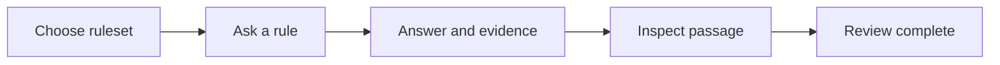

<!--@slide Welcome-->
# Welcome to my Rulebook presentation

**Nevzat Kayıkçı** · Neptun JWM27Z

Computer Science Engineering · University of Pécs

---

<!--@slide Project-->
# Board-game rules companion with source references

A mobile-friendly interface to help players investigate a rule question and inspect supporting rulebook passages.

**The central principle:** a useful answer must be traceable — or it must communicate uncertainty.

---

<!--@slide Problem-->
# One disputed move can interrupt the whole table

**Real incident:** while playing UNO, a group questioned whether +4 could follow +2.

A participant reported that they searched online, read rules and reached a decision.

We do **not** know which edition, website or exact passage was used.

---

<!--@slide Research-->
# One incident informed the main task

**Primary research:** one anonymized retrospective text interview about a concrete rules dispute.

- Reported: question about a specific card combination.
- Reported: group searched online and read rules.
- Design implication: accept situational questions and keep the relevant passage visible.

**Limit:** no population claim, observed task timing or participant emotion.

---

<!--@slide Experience-->
# One task from game selection to reviewed source

**Success in the prototype:** navigate to and review the sample passage, not prove that an actual rule is correct.

---

<!--@slide Reliability-->
# Clear source status prevents false confidence

- The game edition stays visible.
- An example passage is labeled **DEMO / NOT VERIFIED**.
- If context is missing, request a specific detail.
- If evidence is absent or the source cannot load, show a recovery state rather than guessing.

---

<!--@slide Wireframe to prototype-->
# From structure to clickable navigation

Week 6: five main mobile wireframes, critical states and desktop answer view.

Week 7: a clickable task flow with reachable error cases.

Week 8: clearer evidence wording, recovery and contrast-aware semantic colors.

[Current prototype — Week 9](https://www.figma.com/proto/shH7rwYFexBW16cpIfhWZy?node-id=2-4&starting-point-node-id=2%3A4)

---

<!--@slide Iterations-->
# Three changes target inspectability and clarity

| Before | Change | Reason |
| --- | --- | --- |
| An answer could look final | Label demo and unsupported evidence | Honest system status |
| Several next actions competed | Prioritize “Inspect source” | Clear task hierarchy |
| Recovery and inputs were inconsistent | Define focus, error and disabled variants | Predictable and accessible states |

**Evidence:** design review and accessibility principles, not completed peer usability tests.

---

<!--@slide Design system-->
# Reusable components make the interface consistent

Four native Figma component sets with 12 variants: button, rule question field, evidence status card and edition selector.

The source-aware screen has four handoff states: demo, no evidence, missing context and source load error.

[Week 9 Figma components and handoff](https://www.figma.com/design/shH7rwYFexBW16cpIfhWZy)

---

<!--@slide Evaluation-->
# Technical links work; human usability remains untested

**Verified technical checks:** main path 4/4, exception entry links 4/4, 12 component variants and 23 instances across selected task screens.

**Not yet available:** the three independent usability-test records required for Week 8, measured answer correctness and real rulebook retrieval metrics.

Therefore, no claim of improved completion time or learned participant feedback is justified.

---

<!--@slide Limits-->
# The prototype demonstrates decisions, not a full rules engine

It uses a fixed question, simulated answer and placeholder passage. It does not let people type free-form questions or return verified citations to actual rulebook pages.

Next: load a permitted rulebook and test whether players recognize and inspect the correct evidence independently.

---

<!--@slide Reflection-->
# The essential question is whether players trust the right thing

Research suggests that the group checked rule text before deciding.

Design now makes the difference between *sample evidence* and *verified evidence* explicit.

**Open question:** can a player recognize that distinction and recover from an unsupported answer without guidance?

---

<!--@slide Thank you-->
# Thank you for listening

Questions?

Nevzat Kayıkçı · JWM27Z · University of Pécs
