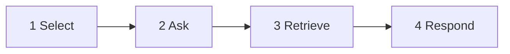

<!--@slide Welcome-->
# Welcome to my project presentation

A quick introduction before we begin

- **Presenter:** Nevzat Kayıkçı
- **Neptun code:** JWM27Z
- **Department:** Computer Science Engineering
- **University:** University of Pécs

---

<!--@slide Main claim-->
# Players need answers they can verify — not guesses

**Rulebook** — a board-game rules companion with source references

A mobile-friendly assistant for situational rules questions

Nevzat Kayıkçı • 2026-SD-02

---

<!--@slide Topic-->
# Why this topic: rules questions interrupt play

**Project:** Rulebook, a board-game rules companion with source references

**Why I chose it:** {{One or two sentences: your own reason, or the moment that made you pick this topic.}}

---

<!--@slide Problem-->
# One game question can depend on several rules

> “Can I do this move in my current situation?”

The answer may depend on a core rule, an expansion rule and the selected edition. The challenge is not just finding a sentence — it is finding the right combination of rules.

**Target user:** players in the middle of a game

***

## Pain points

1. **Search interrupts play** — players leave the game to scan long rulebooks.
2. **Editions can differ** — a correct rule from the wrong version is still wrong.
3. **Context may be missing** — a reliable answer may require a follow-up question.

---

<!--@slide Research-->
# Research showed {{YOUR_STRONGEST_FINDING}}

**Method:** {{e.g. interviews / observation — how many participants?}}

| Insight | Evidence behind it |
| --- | --- |
| {{INSIGHT_1}} | {{quote or observation}} |
| {{INSIGHT_2}} | {{quote or observation}} |
| {{INSIGHT_3}} | {{quote or observation}} |

***

## Persona and journey

- **Persona:** {{name — goal — main frustration}}
- **Journey:** {{the step where the player gets stuck, and what they do instead}}

---

<!--@slide Design decision-->
# Every answer stays inside the selected rules collection

1. **Select** — game, edition and expansions
2. **Ask** — describe the current situation
3. **Retrieve** — find the relevant rule sections
4. **Respond** — explain and cite, clarify, or abstain

If evidence is missing or conflicting, the app asks for clarification or says it cannot establish the answer.

---

<!--@slide Key experience-->
# The source is part of the answer — not a footnote

> **GAME / EDITION / EXPANSION**
>
> **Your question:** Can I move through this space?
>
> **Answer:** Yes — if the movement condition in this section is satisfied.
>
> **SOURCE** • Rulebook, Section 4.2 — Open original context ↗

***

1. **Visible version** — the selected edition stays clear.
2. **Traceable evidence** — open the exact source context.
3. **Honest uncertainty** — ask for missing details or abstain.

---

<!--@slide Feedback and changes-->
# Feedback changed the design: {{WHAT_CHANGED}}

| Feedback received | Change I made | Result |
| --- | --- | --- |
| {{FEEDBACK_1}} | {{CHANGE_1}} | {{OUTCOME_1}} |
| {{FEEDBACK_2}} | {{CHANGE_2}} | {{OUTCOME_2}} |
| {{FEEDBACK_3}} | {{CHANGE_3}} | {{OUTCOME_3}} |

---

<!--@slide Results-->
# Trust was tested, not assumed

Two retrieval approaches were compared on the same checked questions.

- **Baseline:** fixed-size text chunks — retrieves passages by matching text segments.
- **Enhanced approach:** sections + cross-references — uses rule structure and linked sections to gather evidence.

| Success criterion | Baseline | Enhanced | Sample / limitation |
| --- | --- | --- | --- |
| Evidence recall | {{ }} | {{ }} | {{ }} |
| Answer + citation correctness | {{ }} | {{ }} | {{ }} |
| Wrong-edition retrieval | {{ }} | {{ }} | {{ }} |
| Clarification / abstention | {{ }} | {{ }} | {{ }} |
| Response time | {{ }} | {{ }} | {{ }} |

<!-- TODO: replace {{ }} with real numbers. If a measurement is not done yet, write "planned" instead of a result — do not present planned criteria as results. State the small-sample limit. -->

---

<!--@slide Prototype and demo-->
# The prototype proves one decision: the source stays with the answer

**Live demo:** select edition → ask one question → open its citation

- **Prototype:** {{FIGMA_PROTOTYPE_URL}}
- **Backup:** {{3–4 screenshots of the key flow, e.g. ./images/demo-1.png}}

---

<!--@slide Limitations and next step-->
# The first version prioritises traceability over coverage

A focused companion for a few selected games — not an automatic referee for every game.

## In scope

- Selected games + editions
- PDF / Markdown rulebooks
- Saved questions and notes

***

## Not in scope

- Every board game
- A full game engine
- Automated move enforcement

***

## Next step

- Choose permitted rulebooks
- Build source-aware prototype
- Run the checked evaluation

**Limitation:** {{sample size, and what it cannot show}}

---

<!--@slide Reflection-->
# My strongest evidence is {{STRONGEST_EVIDENCE}}

- **What it shows:** {{one sentence}}
- **What I would examine or develop further:** {{one concrete next step}}

A good answer should be useful, verifiable, and willing to say “I don’t know.”

---

<!--@slide Thank you-->
# Thank you for listening

Questions?

Nevzat Kayıkçı • JWM27Z • University of Pécs
